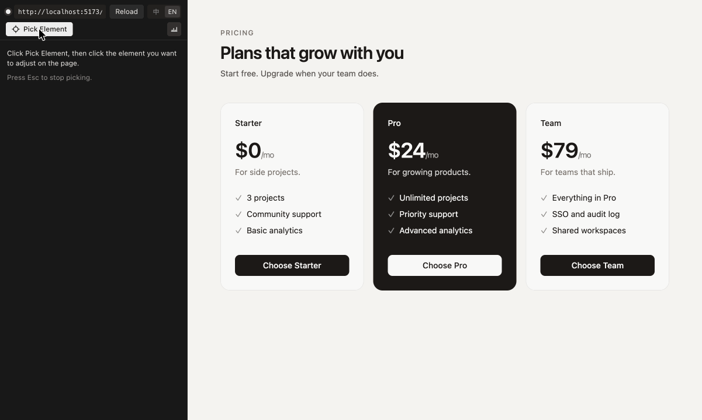

# Cursor CSS Tuner

A Cursor extension: pick elements in the built-in browser, tune their CSS, edit their text and reorder them among their siblings with live preview, write the changes back to your source code deterministically, and revert any single change.



User guide: [English](packages/extension/README.md) · [简体中文](packages/extension/README.zh-CN.md). The rest of this document covers development and is written in Chinese.

---

Cursor 扩展：在内置浏览器里点选元素、可视化调 CSS、改文字、在兄弟之间换序、实时预览，确定性写回源码并可逐条还原。

使用说明、支持范围和限制见 [packages/extension/README.zh-CN.md](packages/extension/README.zh-CN.md)（英文版 [README.md](packages/extension/README.md) 是商店页）；这份文档讲开发。

## 仓库结构

| 目录 | 内容 |
| --- | --- |
| `packages/protocol` | 扩展、页面脚本、面板之间的消息类型和数值工具（颜色、单位换算、刻度） |
| `packages/engine` | 写回引擎：Tailwind 类名改写、CSS 规则改写、CSS 变量、CSS Modules 类名映射；`structure/` 里是结构性写回：JSX 文字和字符串 prop、翻译 JSON（jsonc-parser）、HTML 文字和子元素顺序（parse5）、JSX 子节点换序和 `.map()` 用的数组字面量换序（`reorder.ts`）。纯函数，单元测试最多 |
| `packages/bridge` | 注入到页面里的脚本：点选、高亮、样式快照（命中规则和胜出声明）、文字分段、兄弟组识别（按 fiber 链分叉处分项，`.map()` 渲染的各项单独成组）、预览（样式、文字、用 `order` / 位移模拟的换序）、双击编辑、覆盖层上的拖动把手、应用后校验、元素到源码的定位（React 调试信息 + sourcemap，Next.js 走开发服务器接口） |
| `packages/panel` | 侧栏 webview 面板（React） |
| `packages/extension` | 扩展本体：内置浏览器适配、会话通道、写回计划（样式和文字：元素自己的 JSX、调用处的 prop、`t()` 对应的翻译文件、HTML；换序：JSX 父元素、数组字面量、HTML 父元素）、改动清单、应用与还原、交给 Agent、自检 |
| `fixtures/` | 端到端测试用的小项目：`tw-react`（Vite + Tailwind 4，带 react-i18next）、`react-css`（Vite + 普通 CSS / CSS Modules）、`next16`（Next.js 16 App Router，带 next-intl）、`static-html`；`demo` 是录商店页素材用的英文演示页 |
| `docs/media/` | 商店页和 README 用的动图、截图（README 里用 raw.githubusercontent 的绝对地址引用） |
| `spike/` | Phase 0 的可行性验证脚本（不参与构建） |

一次调参的数据流：扩展用 Cursor 内置浏览器的 CDP 命令把 `bridge` 注入页面 → 页面经带 token 的 WebSocket 连回扩展 → 选中元素时页面上报样式快照、文字分段、兄弟组和源码位置 → 扩展为每个属性、每段文字和兄弟组规划写回目标（Tailwind 类名 / CSS 规则 / 变量定义 / JSX 文字 / 调用处的 prop / 翻译 JSON / HTML / JSX 子节点顺序 / 数组字面量 / 交给 Agent）→ 拖动和输入时页面只做预览 → 应用时 `engine` 计算文本改动、直接写盘 → 页面等热更新（改翻译文件时 Vite 会整页刷新，刷新后再核对）并核对计算样式、文字和兄弟的顺序（按各项文字的字符计数指纹认，和它里面的顺序无关）→ 还原时按快照或语义回退。

## 开发

需要 Node 22、pnpm 11（`corepack enable` 后按 `packageManager` 自动取版本）和最新版 Cursor。

```bash
pnpm install
pnpm build       # bridge → panel → extension
pnpm typecheck
pnpm test
pnpm package     # 产出 packages/extension/dist/cursor-css-tuner.vsix
```

在 Cursor 里调试扩展：先 `pnpm build`，再用开发模式打开一个 fixture 窗口：

```bash
cursor --extensionDevelopmentPath="$PWD/packages/extension" --new-window "$PWD/fixtures/tw-react"
```

fixture 的开发服务器各自启动（`pnpm --filter fixture-tw-react dev`、`pnpm --filter fixture-next16 dev` 等）。改了 `bridge` 或 `panel` 之后要重新 `pnpm build`，扩展构建时会把它们复制进 `packages/extension/media/`。

面板可以脱离 Cursor 在浏览器里调：`pnpm --filter @css-tuner/panel dev`，页面里用模拟宿主驱动。

## 端到端自测

CI 跑不了内置浏览器，端到端测试在本机的 Cursor 里跑：扩展以开发模式启动时，如果 `packages/extension/selftest.json` 存在，就按里面的步骤执行，把结果写到 `out` 指定的文件，跑完可选关闭窗口。正式安装的扩展不会读这个文件，打包时也会排除它。

```json
{
  "out": "/tmp/css-tuner-e2e.json",
  "closeWindow": true,
  "steps": [
    { "do": "backup", "files": ["/abs/path/fixtures/tw-react/src/App.tsx"] },
    { "do": "open", "url": "http://127.0.0.1:5411/" },
    { "do": "select", "selector": "[data-testid=header]", "props": ["padding-left"] },
    { "do": "edit", "props": ["padding-left", "padding-right"], "value": "2rem", "token": "8", "phase": "commit" },
    { "do": "apply" },
    { "do": "fileLine", "file": "/abs/path/fixtures/tw-react/src/App.tsx", "line": 14 },
    { "do": "revert", "index": 0 },
    { "do": "compareFiles", "restore": true }
  ]
}
```

常用步骤：`open`、`serveStatic`、`select`、`hover`、`edit`、`texts`（列出选中元素的文字分段和写回目标）、`editText`（在面板里改一段文字）、`pageEdit`（在页面上双击文字输入，`key` 是 `Enter` 或 `Escape`）、`order`（列出选中元素所在兄弟组和写回目标，`read` 给了时按显示位置读出这组元素的文字）、`reorder`（在面板里把第 `item` 项挪到第 `to` 个）、`pageDrag`（在页面上拖选中元素的把手，放到 `over` 那个元素的前半或后半）、`planWrites`、`apply`、`revert`、`discard`、`diff`、`fileLine` / `fileRange`、`backup` / `compareFiles`（`restore: true` 时把备份写回去）、`viewport`（`scale` 设像素密度）、`exec`（在页面里执行脚本）、`execFallback`（模拟 CSP 拦住 WebSocket：`keep: true` 停在 exec 模式，`end: true` 恢复）、`config`（只改工作区级设置，不碰用户设置）、`locale`（切换扩展这一侧的界面语言）、`dumpState`（导出面板状态）、`screenshot`、`command`（执行编辑器命令）、`selfCheck`、`state`。完整列表见 `packages/extension/src/selftest.ts`。

自测窗口里的内置浏览器标签不在前台时，`requestAnimationFrame` 可能一帧都不跑：靠它驱动的入场动画（比如 GSAP 的滚动入场）会停在 `opacity: 0`，元素看不见、也不能双击编辑。在真实项目上测双击前，先用 `exec` 把要测的元素设成可见。

在别人的项目上跑之前先 `backup` 所有可能被写的文件，结尾用 `compareFiles` 确认字节级一致。

## 商店页素材

`docs/media/` 里的动图和截图用真实的页面和真实的面板状态逐帧合成，演示页是 `fixtures/demo`（`pnpm --filter fixture-demo dev`）：

1. **面板状态**：在开发宿主里跑自测，每一步之后用 `dumpState` 把面板状态导出到 `packages/panel/public/`（这里的 `*.json` 不进仓库）。状态里只有类名、文件位置这类与语言无关的文字，同一份状态可以渲染两种语言。
2. **面板帧**：启动面板调试页，打开 `shots.html?lang=en&spec=/shots.json`。spec 把各帧按网格排开渲染，`drag` 模拟按住数值字段拖动（会显示标尺和刻度），`point` 指定指针落点；渲染完后 `window.__shots` 给出每帧的位置、指针坐标和字段的值。格式见 `packages/panel/src/shots.tsx`。
3. **页面帧**：在 Cursor 内置浏览器里打开演示页，用 `<script>` 加载 `packages/extension/media/bridge.js`，`__cssTunerBridge.boot(...)` 之后通过 `window.__CSS_TUNER__.call('select' | 'hover' | 'preview', ...)` 驱动选中、悬停和预览；应用之后的帧直接改源码，等热更新。
4. **合成**：写一份分镜 JSON（每帧的面板裁切位置、页面截图、指针和停留时间），运行 `node scripts/media/compose.mjs <分镜文件>` 输出动图和静态截图。

截图用 CDP 的 `Page.captureScreenshot`。两个坑：模拟的视口不能比标签页的实际尺寸大，否则超出的部分是错乱的画面；窗口被别的窗口完全挡住时浏览器不出新帧，截图会一直等（`screenshot` 步骤默认 5 秒超时）。

## 依赖的内部接口

这两处都不是公开 API，变化时只需要改对应的适配代码：

- **Cursor 内置浏览器命令**（`workbench.action.openBrowserEditor`、`cursor.browserView.*`）：集中在 `packages/extension/src/browser.ts`；启动时 `selfcheck.ts` 会检查命令是否还在。
- **Next.js 开发服务器的 `/__nextjs_original-stack-frames`**（错误浮层用的栈帧解析接口）：请求和 URL 换算在 `packages/bridge/src/source.ts` 和 `packages/bridge/src/next.ts`；接口不可用时退回直接读 sourcemap。

## 发布

1. 改 `packages/extension/package.json` 的 `version`，在 `packages/extension/CHANGELOG.md` 里写更新内容。
2. 推送同名标签（如 `v0.1.0`），`Release` 工作流会检查、测试、打包，发布到 Open VSX，并把 VSIX 附到 GitHub Release。
3. 首次发布前，在 [open-vsx.org](https://open-vsx.org) 用 GitHub 登录，然后：
   - 在个人资料页关联 Eclipse 账号并签署发布者协议。
   - 在 Namespaces 页创建与 `publisher` 同名的命名空间。
   - 在 Access Tokens 页生成令牌（选这个命名空间、勾选 Publishing only），存为仓库密钥 `OVSX_PAT`。Publishing only 的令牌不能创建命名空间，所以命名空间要先建好。

## 许可

[MIT](LICENSE)
