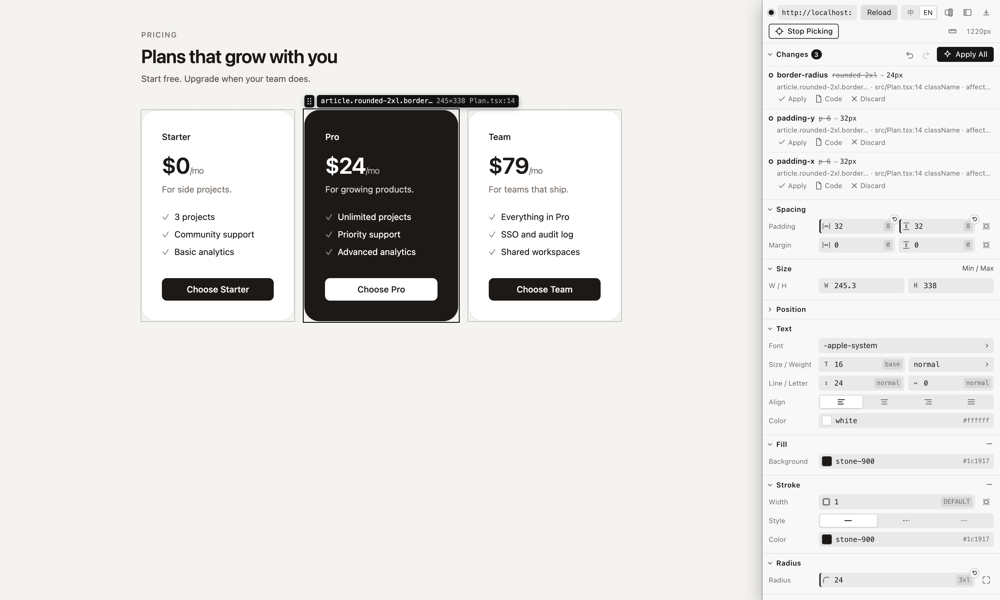

# CSS Tuner for Codex

Pick an element on your running page, drag its values, edit its text, change its component's props or move it among its siblings and watch the page update, then let Codex put the change in your source code and see it checked on the page. Every change can be reverted on its own.

English · [简体中文](README.zh-CN.md)



It does one job: **adjust styles, text, order and props on the page, see the result, and put it in your code**. The tuning panel sits inside the page. When you click Apply, CSS Tuner puts a description of the changes, with a batch number, into the composer of the Codex chat that opened the page; you check it and send. Codex edits the code and asks CSS Tuner to check the page. CSS Tuner doesn't edit your files itself.

## Features

- **Pick elements**: hover to highlight, click to select. The panel says what you picked in plain words, followed by the start of its text (for example *Heading “Welcome”*), and which file it's written in. The Layers section shows the elements around it, and every instance rendered by the same line of JSX or template is marked on the page.
- **Tuning panel**: layout (flex / grid), spacing, size, position, text, fill, stroke, radius, shadow, effects and CSS variables. Drag or scrub numbers and pick colors. Fill and stroke can also be a linear or radial gradient: set the angle, click the gradient bar to add a color stop, drag stops to move them, and pick each stop's color from your theme.
- **Fonts**: the Font field at the top of the Text section opens a searchable list of your theme's fonts (Tailwind's `font-*`, or CSS variables that hold a font stack in plain CSS projects), fonts the page loads with `@font-face`, fonts installed on your computer and generic families. Each name is shown in its own typeface, and hovering one previews it on the page. To use a font that isn't listed, type its name or a whole font stack. When you pick a font that's only installed on your computer, the description says the page doesn't load it.
- **A panel that doesn't cover the page**: by default the page moves over and is laid out in the space next to the panel, so nothing is hidden behind it, and the panel's toolbar shows how wide the page is now. Dock the panel on the left or right, drag its edge to resize it (the page reflows as you drag), or fold it into a small pill to give the page the whole window. To keep the page at the full window width, switch the panel to float over the page. All of this is remembered per site.
- **Add and remove properties**: an element with no fill, stroke or shadow gets one from the + on that section, and − takes it away again. Every value that comes from a declaration in your code has a × in its corner: the page drops it right away, and applying asks Codex to remove the declaration (in Tailwind, its class), so the element falls back to what it would be without it. Inherited values, initial values and framework presets have nothing to remove.
- **Undo, redo and reset**: the change list sits at the top of the panel, folded into one line by default (click it to see each change). Undo and Redo, right next to Apply All (or ⌘Z / ⇧⌘Z, Ctrl+Z / Ctrl+Shift+Z, in the panel), step through the changes you haven't applied yet, and a field with an unapplied change shows a reset button in its corner. The change list follows along.
- **Edit text**: the Content section lists the selected element's text, split into runs around inline tags such as `<b>`. Edit a run there, or double-click text inside the selected element on the page and type in place. Enter adds the change to the list; Esc undoes it.
- **Reorder siblings**: drag the handle next to the selected element's tag on the page, or drag its row in Layers. The page previews the new order with CSS `order` (flex and grid) or transforms instead of moving DOM nodes, so the change is marked “preview only” until you apply it.
- **Edit component props**: the Component props section lists the props that the component rendering the selected element receives at its call site. Strings, numbers and booleans can be edited. Variants of a `cva` / `tailwind-variants` recipe and string literal union types (from TypeScript) are offered as options, including variants the call site doesn't set. The page shows the new value right away through React's DevTools hook, and every instance created by the same call site changes together. Server components are read-only on the page and change once Codex has edited the code.
- **Images & video**: the Images & video section (after Variables, folded by default) lists the images, background images, SVGs and videos you can see in the selected element. *Save* puts one in your Downloads folder, *Download All* saves them all into a new folder there (duplicate names get a number), and you can also copy an SVG's code or show the file in Finder when it's in your project. Images with a `srcset` are saved at their largest size. Saved SVG files use the colors shown on the page, while the copied code keeps `currentColor`. Streaming videos (MediaSource, HLS, DASH) have no complete file to download, but their poster can be saved.
- **Ruler**: turn on the ruler in the panel's toolbar and hover an element on the page to measure its distance from the selected element, with the spacing scale's name next to each number. Click to select the hovered element, and press Esc to leave. With the ruler off, hold Alt while hovering after you select an element.
- **Live preview**: changes only touch the page, not your code. After you hand them to Codex, the preview stays until the page matches it.
- **Codex changes the code**: click Apply All, or Apply on one change. The description of the batch goes into the composer of the Codex chat that opened the page (Codex switches to that chat); check it, add anything you like, and send. It's copied to the clipboard as well, so when CSS Tuner can't reach that chat (for example with the Codex CLI), paste it into a Codex chat. Nothing is sent automatically. The description has one item per element saying where it is and what it should become (several changes to the same element share an item), without prescribing how to write it, and ends with just two requests: consider whether other affected places should change too, asking you when unsure, and list what was changed. Matching theme tokens and CSS variables are included (for example `2rem (Tailwind token 8)`). Where CSS Tuner can pin it down, the description also gives the place in your code:
  - Tailwind classes (Tailwind 4, or Tailwind 3 with the theme from `tailwind.config`): string and template literals in JSX, `clsx` / `cn` / `twMerge` arguments, `cva` base classes and variants, class-name constants, and the `className` passed in at a component's call site. In Vue and Svelte components: the `class` attribute, `:class` strings, arrays and object literals, `class:` directives, and the `class` written where the component is used.
  - Plain CSS: the matching rule and its file. Nesting with `&`, `@import`ed files and CSS Modules are supported (hashed class names map back to the class in your source), as well as Vue `<style scoped>` and Svelte `<style>` blocks.
  - CSS variables: the definition (`:root`, Tailwind's `@theme`), so everything that uses the variable changes together.
  - Text: the text in the JSX; when a component renders text it receives as a prop, the string at the call site (`<Card title="…">` or its children); for messages from `t('key')` (react-i18next, next-intl), the JSON file of the language shown on the page, picked from the route (`/zh/…`) and then `<html lang>`; in plain HTML, the text in the HTML file. Text produced by code comes with the code that produces it.
  - Order: siblings written out in JSX, a list rendered with `.map()` over a constant array literal (in the same file, or imported through relative paths), or child elements in plain HTML. The description lists the siblings in their new order.
  - Props: the component's call site. When the call site also spreads props (`{...rest}`), the panel warns that the spread may override the value.

  When CSS Tuner can't pin a change down (for example classes built from variables, props passed as expressions such as `size={size}`, or lists that come from props or an API), Codex looks for it, and the description passes on what CSS Tuner found out. For an element with no source location at all, it gives the element's text and its place in the page's element tree.
- **Checked automatically**: once Codex has edited a file and the page has hot reloaded, the panel briefly lifts the preview, reads the computed styles, text, order and props your code produces, and marks the change *Applied* when they match the preview, which is then removed. Codex also asks CSS Tuner to check right after editing and fixes what doesn't match. If the page shows something else, the change says what it shows now, and *Send Again* adds that to the description. When an edit makes the dev server reload the whole page (a message file in Vite, a CSS Module in Next.js webpack mode), the check runs again once the page reconnects.
- **Revert one change at a time**: click *Revert* on an applied change to hand Codex a request to change those places back; the change is marked *Reverted* once the page matches again. A change that's still waiting can be dropped with *Discard* (which also removes its preview) or *Don't Revert*.
- **This one or all** (Tailwind): *This one* changes only the element you picked (when the component merges classes with `cn` / `twMerge`, the description points to where the component is used). *All* points to the component itself and its variants, so every place that uses it changes. The choice only appears when the two would change different places in your code, and *All* says how many elements on the page it affects.
- **English and Simplified Chinese**: the panel, its messages and the descriptions handed to Codex follow the browser's language (the Codex in-app browser follows Codex). Switch with 中 / EN at the top of the panel; the choice is saved in the `language` setting.

## Supported projects

| Stack | Status |
| --- | --- |
| React 18 / 19 + Vite, Tailwind 4 | Tested |
| React + Vite, Tailwind 3 (theme from `tailwind.config`) | Tested with 3.4 |
| React + Vite, plain CSS / CSS Modules | Tested |
| Next.js 16 App Router, `next dev` (Turbopack) and `next dev --webpack`, server and client components | Tested |
| react-i18next, next-intl with JSON message files | Text editing, tested |
| Component props | Client components in React 18 / 19 and Next.js, tested; server components aren't previewed and change once Codex has edited them |
| Vue 3 + Vite, Nuxt 4 (`nuxt dev`) | Styles located in classes and `<style>` blocks, tested |
| Svelte 5 + Vite, SvelteKit 3 (`vite dev`) | Styles located in classes and `<style>` blocks, tested |
| Plain HTML + CSS (served by CSS Tuner's built-in static server) | CSS rules, text and order located |

The page must run in development mode: locating an element's source relies on React's development build, the location data Vue and Svelte attach to elements in development, and the dev server's source maps.

## Requirements

- The Codex app, so that Apply can put the prompt into your chat. The Codex CLI works too: open the page in any browser, and Apply copies the prompt to the clipboard.
- Node.js: CSS Tuner runs on Node.js 20 or later from your `PATH`, the Node your dev server uses, so it can load your project's native modules (such as Tailwind 4's lightningcss). Without one, it uses the Node that ships with Codex. Set `CSS_TUNER_NODE` to the path of a `node` binary to choose one yourself.
- Tested on macOS. Launchers for Windows and Linux are included but haven't been tested yet.

## Install

Add this repository as a plugin marketplace, then install the plugin:

```sh
codex plugin marketplace add WYCM9527/Codex-CSS-Tuner
codex plugin add css-tuner@codex-css-tuner
```

This follows the default branch; add `--ref v0.11.1` to stay on a release. From a local clone, pass its path instead: `codex plugin marketplace add /path/to/Codex-CSS-Tuner`. Then start a new Codex conversation (restart the Codex app if the plugin doesn't show up). Nothing needs to be installed in your project.

To update, refresh the marketplace and install again:

```sh
codex plugin marketplace upgrade codex-css-tuner
codex plugin add css-tuner@codex-css-tuner
```

## Quick start

1. Ask Codex: **Open my dev server in CSS Tuner**. Codex starts the dev server if it isn't running yet, opens the page through CSS Tuner (for `http://localhost:5173/` that's `http://localhost:15173/`) and shows it in the in-app browser. Hot reload keeps working through it.
2. Click **Pick Element** in the panel, then click an element on the page.
3. Drag the values in the panel; the page updates as you go, and each change appears in the list at the top of the panel, where Undo and Redo step back and forth through them. To change text, edit it in the Content section or double-click it on the page. To move an element among its siblings, drag the handle next to its tag on the page or its row in Layers. To change the props of its component, use the Component props section.
4. Click **Apply All** (or **Apply** on one change). The description of the batch appears in the Codex composer; check it and send. Once Codex has changed the code and the page has updated, the change in the list turns **Applied**. Afterwards, **Revert** any single change.

For plain HTML, ask Codex to open an HTML file or folder in CSS Tuner, and it serves the files itself. To try it without a project of your own, download the [demo page](https://github.com/WYCM9527/Codex-CSS-Tuner/releases/latest/download/css-tuner-demo.zip), unzip it, start a Codex chat in that folder and ask Codex to **open index.html in CSS Tuner**.

## Tools

Codex uses these tools of the plugin's MCP server; you don't have to call them yourself.

| Tool | What it does |
| --- | --- |
| `open_page` | Opens a dev server URL through the local proxy, or serves a local HTML file or folder, and returns the address to open |
| `status` | Whether the page is connected, which page it's on, and how many changes are pending, handed off or applied |
| `get_handoff` | The full description of a handed-off batch: where each change is in the code and what it should become |
| `verify` | Checks on the page whether the code now produces what the preview showed |
| `list_changes` | Lists the changes with their status and place in the code |
| `close_page` | Closes the project's CSS Tuner pages and stops their proxy |

## Command line

The plugin also has a command line for the same background service, in its `server` folder. Codex installs plugins under `~/.codex/plugins/cache/codex-css-tuner/css-tuner/<version>/`.

```sh
node <plugin folder>/server/cli.mjs open http://localhost:3000/ --root .   # print the address to open
node <plugin folder>/server/cli.mjs status                                  # connection and change counts
node <plugin folder>/server/cli.mjs changes                                 # list changes
node <plugin folder>/server/cli.mjs config scope source                     # change a setting
node <plugin folder>/server/cli.mjs stop                                    # stop the background service
```

## Settings

Settings apply to all projects. Show them with `cli.mjs config` and change one with `cli.mjs config <key> <value>`.

| Setting | Default | Description |
| --- | --- | --- |
| `language` | `auto` | Language of the panel, its messages and the descriptions: `auto` follows the browser's language, or set `zh-CN` / `en`. The 中 / EN switch at the top of the panel changes this setting |
| `defaultUrl` | `http://localhost:5173/` | Address to open when none is given |
| `remBase` | `16` | Root font size used to convert between rem and px |
| `scope` | `instance` | Whether Tailwind changes apply to just the element you picked (`instance`, “This one” in the panel) or to the component itself (`source`, “All”) |
| `editor` | `auto` | Editor for the panel's “open in code” buttons: `auto` tries Cursor, then VS Code. Or a command where `{file}`, `{line}` and `{column}` are replaced |
| `assetsDir` | Downloads | Folder that *Save* and *Download All* write to |

## Limitations

- **Filling in the composer needs the Codex app on this computer**: CSS Tuner opens a `codex://` link to the chat that last called its tools for the project, so it works with the Codex app on macOS and Windows. Before any chat has called its tools, the Codex in-app browser is asked to open an annotation on the page instead; anywhere else, Apply only copies the prompt to the clipboard.
- **The page runs through a local proxy**: CSS Tuner opens your dev server at another port on localhost (usually the original port + 10000), adds the panel script to HTML pages and removes their `Content-Security-Policy` and `X-Frame-Options` headers. Links, redirects and scripts that hard-code the original address (`http://localhost:5173/…`) leave the proxy, and the panel isn't there; open the CSS Tuner address again. Sign-in flows and APIs that only accept the original address (OAuth redirect URLs, CORS allowlists) may not work through it.
- **Next to the panel, the page runs in an iframe**: CSS Tuner opens a page of its own for the panel and loads yours in a frame beside it, so the address bar shows `/__css_tuner__/frame?u=…`. Pages that refuse to run in a frame (they jump back out to the top window) are detected: the panel floats over them instead and says so once. Code that checks whether it's in a frame (`window.top`) may behave differently; if a page misbehaves, switch the panel to float over the page.
- **One tab per site**: if the same page is opened in another tab, the newer tab takes over and the older one shows a button to take it back.
- **Reordering stays within one parent**: it doesn't add or remove elements or move them to another parent. For lists built from props, state, API data, `filter()` / `sort()` results or `let` variables, CSS Tuner can't find the order in your source, so the description only gives the new order and Codex decides how to change it.
- **The order preview is simulated**: flex and grid use `order`; other layouts shift elements with transforms, so with floats, absolute positioning or wrapping inline content the preview can differ slightly from the result.
- **Text is edited as plain text on one line**: line breaks become spaces, and inline tags such as `<b>` stay where they are, so each run around them is edited on its own. Only the message file of the current language changes; other languages are left as they are. For text produced by code (expressions, template strings, custom translation helpers, `t.rich`) and messages with placeholders, CSS Tuner can't pin down the exact spot, so the description includes the code that produces it.
- **Props**: only props written at the call site are listed, plus `cva` / `tailwind-variants` variants that the component passes to its own recipe (under the same name, as the whole props object, or through a spread). Objects, functions and elements are shown read-only. Options from TypeScript come from the TypeScript language service, which can take a few seconds to start in a large project.
- **Vue and Svelte: only styles are located**: changes to text, order and props come without a place in the code, and Codex looks for it. Templates must be HTML (Pug isn't supported), and only plain-CSS `<style>` blocks are recognized; `lang="scss"`, `less` and `stylus` blocks can't be located. Elements rendered by components from `node_modules`, or by Vue components without a template (render functions, JSX), map to the tag where your code uses the component. In Vue only the component's root element maps, since that is where `class` falls through (not with `inheritAttrs: false`); in Svelte a class written there takes effect only if the component applies its `class` prop. Only Vite dev servers are supported; Nuxt and SvelteKit use one.
- **Next.js source locations** come from `/__nextjs_original-stack-frames`, an internal dev server endpoint used by the error overlay, which is not a public API. Both Turbopack (`next dev`) and webpack (`next dev --webpack`) dev modes are tested. Hot reload of server components can take a few seconds, and the check waits for it. In webpack mode, editing a CSS Module can make Next.js reload the whole page.
- **Hot reload edge cases**: an element rendered before a hot reload and selected for the first time after it may point to an old line number. If a location looks wrong, reload the page.
- **CSS Modules** class names are matched by the longest source class name contained in the hashed name, so projects with a custom `generateScopedName` may not map correctly.
- **Tailwind 3 and 4 only**: the design system is loaded from your project's own `node_modules` to name tokens. In Tailwind 3 projects the theme is read from the `tailwind.config.*` named by `@config`, or the nearest one up to the project root. Codex decides how to write values that are off the theme scale. Tailwind 3's `prefix` option isn't supported.
- **Gradient strokes are previewed with two background layers** (`background-clip: padding-box, border-box`), so rounded corners stay. When the element has no opaque fill, the description asks Codex for another way that keeps the corners and leaves the inside transparent. Gradient strokes are always solid. Conic gradients, images and multi-layer backgrounds are shown in the panel but can't be edited there; switching to a solid color or a gradient replaces them.
- **Installed fonts** are listed by the system's font manager on macOS, PowerShell on Windows and fontconfig (`fc-list`) on Linux. If the list can't be read, the Font menu still offers theme, page and generic fonts.
- **Undo and Redo only cover changes you haven't applied**: changes handed to Codex aren't in the history. To take one back, click *Revert* in the list.
- **The check relies on the page updating**: after a change is handed off, the panel waits until the page matches the preview. If Codex didn't change anything, changed a place the page doesn't use, or the dev server didn't hot reload, the change stays *Waiting for Codex*; use *Send Again* or *Discard*.

## Security and privacy

- The proxy and the static server listen on `127.0.0.1` and `::1` only, and the background service's control port on `127.0.0.1`. The page's connection needs a random token for each site, and the control port needs a token kept in `~/.css-tuner/daemon.json`, which only you can read.
- CSS Tuner doesn't modify your project files; Codex edits them after you send the request.
- CSS Tuner makes no internet requests of its own. The proxy only connects to dev servers on this computer or your local network (localhost, private and link-local addresses, and host names that resolve to them) and refuses public websites. When you save an image or video, CSS Tuner downloads that file from the address the page uses. The list of installed fonts is read on your computer, with the system tools above, the first time you open the Font menu.
- Settings, change history, the id of the Codex chat that uses each project (so Apply knows where to put the prompt) and logs are kept in `~/.css-tuner` (set `CSS_TUNER_DATA` to use another folder). The background service stops by itself after 30 minutes without a connected page.
- Details are in the [privacy policy](https://github.com/WYCM9527/Codex-CSS-Tuner/blob/main/PRIVACY.md) and the [terms of use](https://github.com/WYCM9527/Codex-CSS-Tuner/blob/main/TERMS.md).

## Troubleshooting

- Ask Codex for the CSS Tuner status, or run `node <plugin folder>/server/cli.mjs status`.
- The background service's log is `~/.css-tuner/logs/daemon.log`.
- *The dev server isn't responding*: start it, and the page reloads by itself.
- *CSS Tuner is in use in another tab*: click it to use CSS Tuner in this tab.
- *Nothing appeared in the composer after Apply*: the prompt is on the clipboard, so paste it into Codex. You can also ask Codex to write your CSS Tuner changes into the code; it fetches the latest batch that's waiting.
- *Can't find this element in the code* for a selected element: make sure the page is served by the dev server in development mode (for React, with React's development build).

## License

MIT. This is a community project and is not affiliated with OpenAI.
