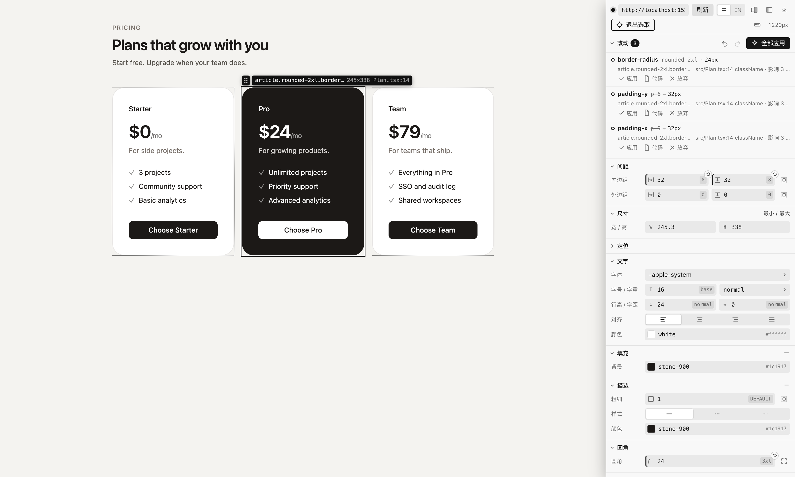

# CSS Tuner for Codex

在运行中的页面上点选元素，拖动数值、改文字、改组件的属性或在兄弟之间换位置，实时看效果，满意了交给 Codex 写进源码，页面上自动核对，每一条都能单独还原。

[English](README.md) · 简体中文



它要解决的事只有一件：**在页面上调样式、改文字、调顺序、改属性、看效果，再把效果写进代码里**。调参面板就在页面里。点“应用”时，CSS Tuner 把改动说明（带批次号）放进打开这个页面的 Codex 对话的输入框，由你检查后发送；Codex 改代码，再请 CSS Tuner 到页面上核对。CSS Tuner 自己不改代码文件。

## 能做什么

- **点选元素**：点一次“选取元素”进入自由选择：页面上悬停的元素描出虚线框，点哪个选哪个，接着点别的元素直接切换，再点一次按钮退出；开着时页面上的点击不交给页面，把面板收成胶囊时一起退出。选中的元素平时不画框，免得挡住效果；鼠标移开再移回它身上，才画出实线框、代码位置和换序把手，并标出同一处 JSX 或模板渲染出的所有实例。面板用大白话说出选中的是什么，后面跟着它的文字开头（比如“标题 “欢迎””），并标出写在哪个文件；“图层”分区列出它周围的元素。
- **调参面板**：布局（flex / grid）、间距、尺寸、定位、文字、填充、描边、圆角、投影、效果、CSS 变量。数值可拖动、可滑动，颜色有取色器。填充和描边还可以用线性或径向渐变：改角度，点渐变条加颜色点，拖动颜色点改位置，每个颜色点都能选主题里的颜色。
- **字体**：“文字”分区第一行的“字体”打开一个可搜索的列表，列出主题里的字体（Tailwind 的 `font-*`；普通 CSS 项目里存字体栈的 CSS 变量）、页面用 `@font-face` 加载的字体、本机装的字体和通用字体族。每个名字用它自己的字形显示，悬停即在页面上预览；列表里没有的字体，直接输入名字或整串字体栈。选了只装在本机的字体时，说明里会写明页面没有加载它。
- **不挡页面的面板**：默认页面挪到面板旁边，按剩下的宽度排版，不会被面板盖住，面板的工具栏上写着页面现在多宽。面板可以停靠在左边或右边，拖边缘改宽度（页面跟着重新排版），也可以收成一个小胶囊，把整个窗口让给页面。想让页面保持整个窗口的宽度，可以把面板切成浮在页面上。这些都按站点记住。
- **增删属性**：没有填充、描边或投影的元素，点对应分区上的 + 直接加上，点 − 去掉。来自源码声明的值右上角都有 ×，点了页面上先去掉它，应用时请 Codex 删掉这条声明（Tailwind 里是对应的类名），元素回到没有它时的样子；继承来的值、初始值和框架预设样式没有可删的。
- **撤销、重做和重置**：改动清单在面板顶部，默认收成一行（点一下展开看每一条）。“全部应用”左边的上一步 / 下一步（在面板里也可以按 ⌘Z / ⇧⌘Z，或 Ctrl+Z / Ctrl+Shift+Z）在还没应用的改动之间前进后退；有未应用改动的参数，右上角会出现重置按钮。改动清单随时同步。
- **改文字**：面板的“内容”分区列出选中元素里的文字，遇到 `<b>` 这类行内标签会分成几段。可以在面板里改某一段，也可以在页面上双击文字直接输入：开着自由选择时双击哪里改哪里，关着时只认选中元素里的文字；回车或点别处加进改动清单，Esc 撤销。
- **兄弟换序**：开着自由选择时把鼠标移回选中元素上，拖它标签旁边的把手；或在“图层”里拖它那一行。页面上的新顺序用 CSS `order`（flex 和 grid）或位移摆出来，不移动真实的 DOM 节点，所以应用前这条改动会标成“仅预览”。
- **改组件属性**：面板的“组件属性”分区列出渲染选中元素的那个组件在调用处收到的属性。字符串、数字、布尔值可以改；`cva` / `tailwind-variants` 配方的变体和字符串字面量联合类型（来自 TypeScript）会列成选项，调用处没写的变体也会列出来。页面通过 React 的 DevTools 钩子立刻显示新值，同一个调用处创建的实例一起变。服务端组件在页面上只读，Codex 改完代码后生效。
- **图片和视频**：面板的“图片和视频”分区（在“变量”后面，默认收起）列出选中元素里看得见的图片、背景图、SVG 和视频。“保存”存进「下载」文件夹，“全部下载”存进那里新建的一个文件夹（重名自动加序号）；还可以复制 SVG 代码，项目里的文件可以在访达里显示。带 `srcset` 的图片下载最大的那张；存下来的 SVG 文件把颜色换成页面上显示的颜色，复制的代码保留 `currentColor`。边加载边播放的视频（MediaSource、HLS、DASH）没有完整文件可下载，封面图可以单独下载。
- **标尺**：点面板工具栏上的标尺，在页面上悬停元素，量它和选中元素之间的距离，数字旁边标着间距刻度名；点一下改选中它，按 Esc 关掉标尺（自由选择照旧开着）。不开标尺时，选中元素后在页面上按住 Alt 悬停也能量。
- **实时预览**：改动先只作用在页面上，不碰源码；交给 Codex 之后预览也一直留着，直到页面对上为止。
- **该联动的才联动**：同一处 JSX 或模板渲染出好几个元素时（三张价格卡、列表的每一行），改其中一个，只有这个属性在代码里出自同一处的那些跟着变。三张卡片的内边距都来自 `p-6`，三张一起变；推荐卡片的底色写在条件的一个分支里，另外两张的写在另一个分支里，改这两张里的一张，另一张跟着变，推荐卡片不动。继承来的值看它是从哪里继承的：标题的文字颜色跟着它所在的卡片走。同一个类在条件的两个分支里都写着、或者几个变体里都写着时，只改选中元素用的那一处；写在 `style` 里的值按值分组。普通 CSS 里，往命中好几个元素的规则里加属性时，也只预览出自同一处的那几个。每个参数的悬停提示和改动清单里标着这条改动影响几个元素，说明里会告诉 Codex 只改哪几个、其余的保持不变。
- **交给 Codex 改代码**：点“全部应用”或某一条的“应用”。这一批改动的说明会放进打开这个页面的 Codex 对话的输入框（Codex 会切到那个对话），检查一下、想补充就补充，再发送。说明同时复制到剪贴板，CSS Tuner 联系不上那个对话时（比如用的是 Codex CLI），粘贴到 Codex 对话里就行。不会自动发送。说明里每个元素一项，写明在哪、要改成什么样（同一个元素的几处改动合在一项里），不规定具体写法；最后只提两点要求：斟酌受影响的其他地方要不要一起改、拿不准先问你，改完列出改了哪里。用得上的主题令牌和 CSS 变量会一起给出（如 `2rem（Tailwind 令牌 8）`）。CSS Tuner 能定位到的，还会写上代码位置：
  - Tailwind 类名（Tailwind 4；Tailwind 3 的主题来自 `tailwind.config`）：JSX 里的字符串和模板字符串、`clsx` / `cn` / `twMerge` 参数、`cva` 的基础类和变体、类名常量、组件调用处传进去的 `className`；Vue 和 Svelte 组件里是 `class` 属性、`:class` 的字符串 / 数组 / 对象字面量、`class:` 指令，以及使用组件处写的 `class`。
  - 普通 CSS：命中的那条规则和它所在的文件；支持嵌套 `&`、`@import` 进来的文件和 CSS Modules（带哈希的类名会映射回源码里的类名），以及 Vue 的 `<style scoped>` 和 Svelte 的 `<style>` 样式块。
  - CSS 变量：定义处（`:root`、Tailwind 的 `@theme`），用到它的地方一起变。
  - 文字：JSX 里的文字；组件渲染的是传进来的 prop 时，是调用处的字符串（`<Card title="…">` 或子元素）；来自 `t('key')` 的文案（react-i18next、next-intl）是页面当前语言的 JSON 文件，语言先看地址里的语言段（`/zh/…`），再看 `<html lang>`；纯 HTML 是 HTML 文件里的文字。由代码生成的文字会带上生成它的代码。
  - 顺序：JSX 里写死的兄弟、用 `.map()` 渲染的常量数组（同一个文件里，或通过相对路径导入）、纯 HTML 里的子元素；说明里写明兄弟的新顺序。
  - 属性：组件的调用处。调用处还有展开写法（`{...rest}`）时，面板会提醒展开的值可能盖掉它。

  定位不到的（比如类名来自变量拼接，属性传的是 `size={size}` 这样的表达式，列表来自 props 或接口数据），由 Codex 自己找，说明里附上 CSS Tuner 知道的线索；连元素的源码位置都没有时，给出它的文字和在页面上的层级。
- **自动核对**：交出去之后，Codex 改了文件、页面热更新，面板就临时撤下预览，读出源码给出的计算样式、文字、顺序和属性，和预览一致就标成“已应用”，预览随之撤掉。Codex 改完也会请 CSS Tuner 马上核对，对不上的接着改。对不上时，这条改动下面写明页面现在的样子，点“再发一次”，说明会带上上一次的结果。同一处代码渲染出好几个元素时，核对会把它们都看一遍：该变的都变了，其余的没被带着变；不是这样的话，这条改动下面写明变了几个，继续等。改的文件让开发服务器整页刷新时（Vite 里改翻译文件、Next.js 的 webpack 模式里改 CSS Module），页面重新连上后再核对。
- **逐条还原**：已应用的改动点“还原”，同样交给 Codex，请它把这几处改回原样，改回后标成“已还原”。还在等的改动可以“放弃”（撤掉预览和这一条）或“不还原了”。
- **只改这个还是全部**（Tailwind）：“只改这个”只改选中的这一个元素（组件用 `cn` / `twMerge` 合并类名时，说明指向用到组件的地方）；“全部”指向组件本身和它的变体，所有用到它的地方一起变。两种改法会改到代码里不同地方时才给这个选项，“全部”后面标着页面上会变几个元素。
- **中英双语**：面板、提示和交给 Codex 的说明跟随浏览器的语言（Codex 内置浏览器跟着 Codex）；也可以点面板顶部的“中 / EN”切换，选择会记在 `language` 设置里。

## 支持的项目

| 技术栈 | 状态 |
| --- | --- |
| React 18 / 19 + Vite，Tailwind 4 | 已验证 |
| React + Vite，Tailwind 3（主题来自 `tailwind.config`） | 3.4 已验证 |
| React + Vite，普通 CSS / CSS Modules | 已验证 |
| Next.js 16 App Router，`next dev`（Turbopack）和 `next dev --webpack`，服务端组件和客户端组件 | 已验证 |
| react-i18next、next-intl，JSON 翻译文件 | 文字编辑已验证 |
| 组件属性 | React 18 / 19 和 Next.js 的客户端组件已验证；服务端组件不能预览，Codex 改完后生效 |
| Vue 3 + Vite，Nuxt 4（`nuxt dev`） | 样式定位到类名和样式块，已验证 |
| Svelte 5 + Vite，SvelteKit 3（`vite dev`） | 样式定位到类名和样式块，已验证 |
| 纯 HTML + CSS（用 CSS Tuner 自带的静态服务打开） | 定位 CSS 规则、文字和顺序 |

页面必须跑在开发模式下：元素到源码的定位依赖 React 开发构建的调试信息、Vue 和 Svelte 开发态挂在元素上的位置信息，以及开发服务器的 sourcemap。

## 需要什么

- Codex 应用：“应用”要靠它把提示词放进对话。Codex CLI 也能用：页面在任意浏览器里打开，“应用”把提示词复制到剪贴板。
- Node.js：CSS Tuner 用 `PATH` 里 20 或更新版本的 Node.js 运行，也就是开发服务器用的那个，这样才加载得了项目里的原生模块（比如 Tailwind 4 用的 lightningcss）；没有时用 Codex 自带的 Node。想自己指定就把环境变量 `CSS_TUNER_NODE` 设成 `node` 的路径。
- 在 macOS 上验证过；Windows 和 Linux 的启动脚本也带了，但还没有实测。

## 安装

在 Codex 应用里点几下就能装好：

1. 点左边栏的“插件”图标，再点页面右上角的“添加”，选“添加插件市场”。
2. “来源”填 `WYCM9527/Codex-CSS-Tuner`，“Git 引用”和“稀疏路径”留空，点“添加市场”。
3. 切到插件页的“个人”标签，点 CSS Tuner 右边的“+”。

用终端的话，运行下面两条命令效果一样；也可以把它们发给 Codex，让它替你运行：

```sh
codex plugin marketplace add WYCM9527/Codex-CSS-Tuner
codex plugin add css-tuner@codex-css-tuner
```

这样装的是默认分支上的版本。想固定在某个发布版本，就在“Git 引用”里填它的标签，比如 `v0.14.0`（命令行加 `--ref v0.14.0`）。用本地克隆的话，“来源”填克隆的路径（命令行：`codex plugin marketplace add /path/to/Codex-CSS-Tuner`）。装好后开一个新的 Codex 对话（插件没出现就重启一下 Codex 应用）。项目里不需要装任何东西。

更新时在插件页右上角点齿轮图标（“管理”），切到“市场”，在 CSS Tuner 这一行点“升级”，已经装上的插件会跟着换成新版本。命令行是：

```sh
codex plugin marketplace upgrade codex-css-tuner
```

## 快速开始

1. 跟 Codex 说：**用 CSS Tuner 打开我的开发服务器**。开发服务器还没跑的话 Codex 会先启动它，再通过 CSS Tuner 打开页面（`http://localhost:5173/` 对应 `http://localhost:15173/`），显示在内置浏览器里；热更新照常工作。
2. 点面板上的“选取元素”，在页面上点一个元素；之后点别的元素直接切换，再点一次按钮退出选取。
3. 拖动面板里的数值，页面实时变化；改动会出现在面板顶部的清单里，上一步 / 下一步可以前进后退。要改文字，在“内容”分区里改，或者在页面上双击它。要在兄弟之间换位置，把鼠标移回它身上、拖标签旁边的把手，或拖“图层”里它那一行。要改它所属组件的属性，用“组件属性”分区。
4. 点“全部应用”（或某一条的“应用”），这一批改动的说明会出现在 Codex 的输入框里，检查后发送。Codex 改完代码、页面更新后，清单里这一条会变成“已应用”；之后可以对任意一条点“还原”。

第 1 步不用照着原话说，Codex 会自己判断要不要用 CSS Tuner：话里提到 CSS Tuner，或者说了想调样式（比如**打开这个项目预览，我想调一下间距和颜色**），它就会用；只说**打开这个项目预览**的话，它多半直接在内置浏览器里打开，页面上没有面板。最稳的是在输入框里输入 `@`，从“插件”里选 CSS Tuner，再写要做的事（接着输入 `css` 可以筛选列表，用中文输入法时先切到英文）。

纯 HTML 项目：请 Codex 用 CSS Tuner 打开某个 HTML 文件或文件夹，CSS Tuner 自己起一个静态服务。手头没有项目也想试试的话，下载[示例页](https://github.com/WYCM9527/Codex-CSS-Tuner/releases/latest/download/css-tuner-demo.zip)解压，在那个文件夹里开一个 Codex 对话，跟它说：**用 CSS Tuner 打开 index.html**。

## 工具

Codex 通过插件里的 MCP 服务调用这些工具，不需要你手动调用。

| 工具 | 说明 |
| --- | --- |
| `open_page` | 通过本地代理打开开发服务器的地址，或者给本地 HTML 文件、文件夹起静态服务，返回要打开的地址 |
| `status` | 页面连上没有、在哪个页面、有多少条改动待应用 / 已交出 / 已应用 |
| `get_handoff` | 交出去的那一批的完整说明：每条改动在代码里的位置、要改成什么样 |
| `verify` | 在页面上核对代码现在给出的结果和预览是否一致 |
| `list_changes` | 列出改动，带状态和代码位置 |
| `close_page` | 关掉这个项目的 CSS Tuner 页面，停掉它们的代理 |

## 命令行

插件的 `server` 文件夹里还有一个命令行，操作的是同一个后台服务。Codex 把插件装在 `~/.codex/plugins/cache/codex-css-tuner/css-tuner/<版本>/`。

```sh
node <插件目录>/server/cli.mjs open http://localhost:3000/ --root .   # 输出要打开的地址
node <插件目录>/server/cli.mjs status                                  # 连接状态和改动数量
node <插件目录>/server/cli.mjs changes                                 # 列出改动
node <插件目录>/server/cli.mjs config scope source                     # 改一项设置
node <插件目录>/server/cli.mjs stop                                    # 停掉后台服务
```

## 设置

设置对所有项目生效。`cli.mjs config` 查看，`cli.mjs config <键> <值>` 修改。

| 设置 | 默认值 | 说明 |
| --- | --- | --- |
| `language` | `auto` | 面板、提示和说明用的语言：`auto` 跟随浏览器的语言，也可以设成 `zh-CN` / `en`。面板顶部的“中 / EN”改的就是这个设置 |
| `defaultUrl` | `http://localhost:5173/` | 没给地址时打开的地址 |
| `remBase` | `16` | rem 和 px 换算用的根字号 |
| `scope` | `instance` | Tailwind 项目里默认只改选中的这一个（`instance`，面板上的“只改这个”），还是改组件本身（`source`，“全部”） |
| `editor` | `auto` | 面板上“打开代码”用的编辑器：`auto` 依次试 Cursor、VS Code；也可以写命令，`{file}`、`{line}`、`{column}` 换成位置 |
| `assetsDir` | 「下载」 | “保存”和“全部下载”存到哪个文件夹 |

## 限制

- **放进输入框要这台电脑上有 Codex 应用**：CSS Tuner 用 `codex://` 链接打开最近调用过它的工具的那个对话，所以要有 macOS 或 Windows 版的 Codex 应用。还没有对话调用过它的工具时，在 Codex 内置浏览器里改为请 Codex 在页面上打开注释框；在别的地方，“应用”只把提示词复制到剪贴板。
- **页面经过本地代理**：CSS Tuner 在 localhost 的另一个端口（一般是原端口 + 10000）打开开发服务器，给 HTML 页面加上面板脚本，去掉它们的 `Content-Security-Policy` 和 `X-Frame-Options` 响应头。写死原地址（`http://localhost:5173/…`）的链接、跳转和脚本会离开代理，到那边就没有面板了，重新打开 CSS Tuner 的地址即可。只认原地址的登录流程和接口（OAuth 回调地址、CORS 白名单）经过代理可能用不了。
- **停靠时页面在 iframe 里**：CSS Tuner 打开自己的一页放面板，把你的页面放进旁边的框里，所以地址栏显示的是 `/__css_tuner__/frame?u=…`。不让放进 iframe 的页面（放进去后自己跳回顶层）会被认出来，面板改成浮在页面上，并提示一次。判断自己是不是在框里（`window.top`）的代码可能表现不同；页面不对劲时把面板切成浮在页面上。
- **一个站点一个标签页**：同一个页面在另一个标签页里打开时，新的标签页接手，旧的那个页面上有按钮可以拿回来。
- **换序只在同一个父元素里**：不会增加、删除元素，也不会把元素挪到别的父元素下。来自 props、state、接口数据、`filter()` / `sort()` 结果或 `let` 变量的列表，CSS Tuner 找不到源码里的顺序，说明里只写新顺序，由 Codex 决定怎么改。
- **换序预览是模拟的**：flex 和 grid 用 `order`，其他布局用位移把元素挪过去；遇到浮动、绝对定位或折行的行内内容，预览和应用后的效果可能略有差别。
- **文字按单行纯文本改**：换行会变成空格；`<b>` 这类行内标签留在原位，它前后的文字各自单独改。只改当前语言的翻译文件，其他语言保持原样。由代码生成的文字（表达式、模板字符串、自己写的翻译函数、`t.rich`）和带占位符的翻译，CSS Tuner 定位不到确切位置，说明里会带上生成它的代码。
- **属性**：只列出调用处写了的属性，另外加上组件传给自己配方的 `cva` / `tailwind-variants` 变体（同名传、整个 props 对象传或展开传）。对象、函数和元素只读。TypeScript 给出的选项来自 TypeScript 语言服务，大项目里它启动要几秒。
- **Vue 和 Svelte 只定位样式**：文字、换序和属性的改动不带代码位置，由 Codex 自己找。模板必须是 HTML（不支持 Pug），只认普通 CSS 的 `<style>` 块，`lang="scss"`、`less`、`stylus` 的样式块定位不到。`node_modules` 里的组件、以及没有模板的 Vue 组件（渲染函数、JSX）渲染出的元素，定位到你的代码里使用这个组件的标签：Vue 只有组件的根元素能定位过去，因为 `class` 只透传到根元素（`inheritAttrs: false` 时也不透传）；Svelte 写在那里的类名要组件自己把 `class` 属性用上才生效。只支持 Vite 开发服务器，Nuxt 和 SvelteKit 用的就是它。
- **Next.js 的源码定位**借用开发服务器给错误浮层用的内部接口 `/__nextjs_original-stack-frames`，不是公开 API；Turbopack（`next dev`）和 webpack（`next dev --webpack`）两种开发模式都验证过。服务端组件的热更新可能要几秒，核对会等。webpack 模式下改 CSS Module 可能让 Next.js 整页刷新。
- **热更新的边界情况**：热更新之前就渲染出来、热更新之后才第一次选中的元素，可能定位到旧的行号；位置看起来不对时刷新一下页面。
- **CSS Modules** 的类名映射是按“哈希类名里包含的最长源码类名”匹配的，自定义了 `generateScopedName` 的项目可能对不上。
- **Tailwind 只支持 v3 和 v4**：设计系统从项目自己的 `node_modules` 加载，用来给出令牌。Tailwind 3 项目的主题读 `@config` 指定的 `tailwind.config.*`，没写的话从入口往上找到项目根为止最近的那个。刻度外的值怎么写由 Codex 决定。不支持 Tailwind 3 的 `prefix` 选项。
- **渐变描边的预览用两层背景叠出来**（`background-clip: padding-box, border-box`），圆角保留；元素没有不透明的填充色时，说明里会请 Codex 换一种保留圆角、里面透明的写法。渐变描边只能是实线。圆锥渐变、图片和多层背景在面板里只显示、不能改，换成纯色或渐变会把它们替换掉。
- **联动按值的出处比**：同一处代码渲染出的元素里，某个属性来自同一条规则或同一个类、`style` 里写着同样的值、或者从同一处声明继承来的，才算一样。条件的一个分支包含了另一个分支的全部类名时，CSS Tuner 分不出元素用的是哪个分支，两个分支的元素会一起变；同一个类既写在固定的那段里、又写在某个分支里时，算到哪一段是估的。同一处代码渲染出几千个元素时（一般的 Tailwind 页面大约六千个起，样式表特别大的更少），逐个比较会拖慢面板，照旧全部一起变；普通 CSS 里命中超过 3000 个元素的规则也不分。交给 Codex 之后，只有在其余元素不超过 2000 个、各自的计算值相同（百分比、`em` 通常不同）、个数也没变时才一起核对，否则只核对选中的那个。
- **本机字体**：macOS 从系统的字体管理器读，Windows 用 PowerShell，Linux 用 fontconfig（`fc-list`）。读不到时，字体菜单里仍有主题、页面和通用字体。
- **上一步 / 下一步只管还没应用的改动**：已经交给 Codex 的改动不在历史里，要撤回，在清单里点“还原”。
- **核对靠页面更新**：交给 Codex 之后，面板一直等到页面和预览对上为止。Codex 没改、改到了页面没用到的地方，或开发服务器没有热更新时，这一条会停在“等 Codex 改”，可以“再发一次”或“放弃”。

## 安全与隐私

- 代理和静态服务只监听 `127.0.0.1` 和 `::1`，后台服务的控制端口只监听 `127.0.0.1`。页面的连接要带每个站点各自的随机 token，控制端口要带 `~/.css-tuner/daemon.json` 里的 token，这个文件只有你自己能读。
- CSS Tuner 不改项目文件；代码由 Codex 在你发送之后修改。
- CSS Tuner 自己不访问外网：代理只连本机或局域网里的开发服务器（localhost、内网和链路本地地址，以及解析到这些地址的主机名），公网网站一律拒绝；保存图片或视频时，从页面用的那个地址下载。本机字体列表在第一次打开字体菜单时用上面说的系统工具在本机读取。
- 设置、改动记录、在用每个项目的 Codex 对话的 id（“应用”靠它知道提示词放进哪个对话）和日志放在 `~/.css-tuner`（设置 `CSS_TUNER_DATA` 可以换地方）。没有页面连着时，后台服务 30 分钟后自己退出。
- 详见[隐私政策](https://github.com/WYCM9527/Codex-CSS-Tuner/blob/main/PRIVACY.md)和[使用条款](https://github.com/WYCM9527/Codex-CSS-Tuner/blob/main/TERMS.md)。

## 排查问题

- 问 Codex CSS Tuner 的状态，或者运行 `node <插件目录>/server/cli.mjs status`。
- 后台服务的日志在 `~/.css-tuner/logs/daemon.log`。
- 页面显示“开发服务器没有响应”：把开发服务器启动起来，页面会自己刷新。
- 页面显示“CSS Tuner 正在另一个标签页里用着”：点它，改在这个标签页里用。
- 页面上的链接、按钮点了没反应：选取元素或标尺还开着，开着时点击不交给页面。点面板上的“退出选取”（标尺按 Esc 关掉），或者把面板收起来。
- 点了“应用”，输入框里没出现说明：提示词在剪贴板里，粘贴给 Codex 即可；也可以直接跟 Codex 说“把 CSS Tuner 里的改动写进代码”，它会取最近一批在等的改动。
- 选中元素后面板显示“找不到这个元素在代码里的位置”：确认页面由开发服务器以开发模式提供（React 项目还要是 React 的开发构建）。

## 许可

MIT。这是社区项目，与 OpenAI 官方无关。
